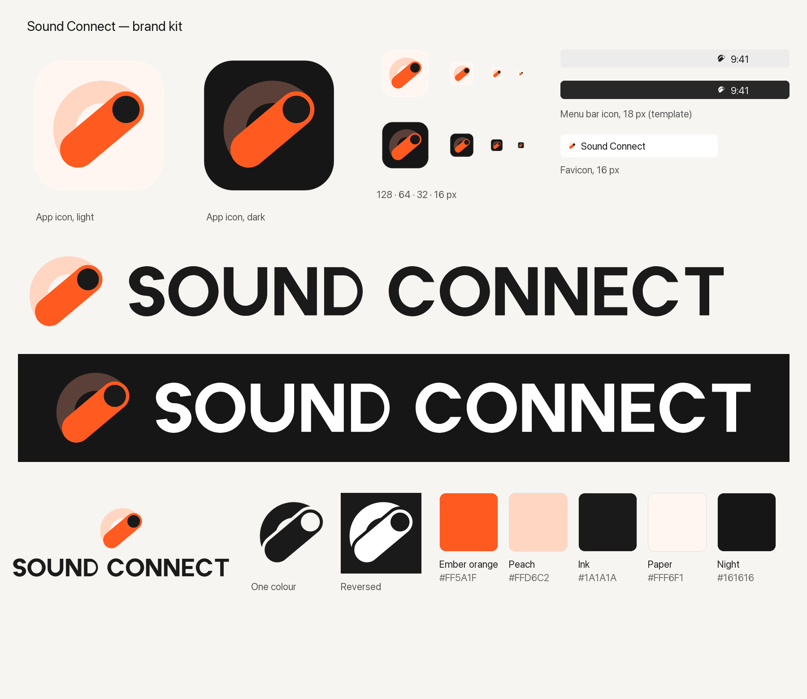

# Sound Connect brand kit



**The idea:** a switch, flipped on, under a headband. Sound Connect is the
control for your headphones, so the headphones become the control.

The symbol is three shapes: a peach headband, an orange switch and an ink
knob at the "on" end. The switch is tilted 40° so the mark leans forward.

## Colours

| Name | HEX | RGB | Use |
| --- | --- | --- | --- |
| Ember orange | `#FF5A1F` | 255 90 31 | The switch. The brand colour; use it for one thing per screen |
| Peach | `#FFD6C2` | 255 214 194 | The headband on light backgrounds |
| Ink | `#1A1A1A` | 26 26 26 | The knob, the wordmark, one-colour marks |
| Paper | `#FFF6F1` | 255 246 241 | Light app icon tile, light backgrounds |
| Night | `#161616` | 22 22 22 | Dark app icon tile, dark backgrounds |
| Band on dark | `#5A4038` | 90 64 56 | The headband on Night (peach would be too loud there) |

Ember orange as text needs a dark background, or a large size: on white it
reaches 3.1:1, enough for headings of 24 px and up, not for body text. On
Night it reaches 5.8:1.

## Files

| File | Use it for |
| --- | --- |
| `svg/soundconnect-symbol.svg` | The symbol on light backgrounds |
| `svg/soundconnect-symbol-on-dark.svg` | The symbol on dark backgrounds |
| `svg/soundconnect-symbol-mono-{black,white,orange}.svg` | One colour: print, stamps, engraving, single-ink |
| `svg/soundconnect-symbol-small.svg`, `-small-colour.svg` | 32 px and below (wider gaps, bigger knob) |
| `svg/soundconnect-wordmark.svg`, `-white.svg` | The name alone |
| `svg/soundconnect-lockup-horizontal*.svg` | Symbol + name side by side: headers, README, website |
| `svg/soundconnect-lockup-horizontal-on-dark.svg` | The same, transparent, for dark pages (GitHub dark mode) |
| `svg/soundconnect-lockup-stacked.svg` | Symbol over name: square spaces, splash screens |
| `svg/soundconnect-appicon-{light,dark}.svg` | macOS app icon on the 1024 grid (824 tile, 185 radius) |
| `svg/soundconnect-appicon-fullbleed.svg` | iOS, Android and web icons; the system applies the mask |
| `macos/SoundConnect.icns` | Drop-in macOS app icon (16–1024 px) |
| `macos/menubar/MenuBarIcon*.png`, `.svg` | Menu bar status item. Set it as a template image so macOS tints it |
| `web/` | `favicon.svg`, `favicon.ico` (16/32/48), `apple-touch-icon.png`, `icon-192/512.png` |
| `png/` | Ready-made PNGs of the symbol, icons and lockups |

Web `<head>`:

```html
<link rel="icon" href="/favicon.ico" sizes="any">
<link rel="icon" href="/favicon.svg" type="image/svg+xml">
<link rel="apple-touch-icon" href="/apple-touch-icon.png">
```

## Rules

- **Clear space:** keep a margin equal to the knob's diameter on every side.
- **Minimum size:** the full symbol at 32 px; below that use the small cut.
  The horizontal lockup at 96 px wide.
- **Lockups:** don't rebuild them. In the horizontal lockup the symbol is
  1.45× the cap height, with a gap of 0.55× the cap height.
- **Backgrounds:** Paper, white or Night. On photos, use the one-colour
  white or black mark.

Don't:

- recolour the switch or swap which part is orange;
- straighten the tilt or flip the mark (the knob sits top right: "on");
- add shadows, gradients, outlines or glow;
- set "Sound Connect" in another typeface next to the symbol;
- squash, stretch or crop the mark.

## Wordmark

The letters are drawn from geometry, not set in a font, so there is no font
licence to worry about. The letters share one stroke weight; the S is a single stroke along two arcs.

## Rebuilding

Everything in `svg/` is generated by `src/build.py` (geometry, real
cut-outs, lockups). It needs Python with `skia-pathops` and `fontTools`:

```sh
python -m venv .venv && .venv/bin/pip install skia-pathops fonttools
.venv/bin/python src/build.py
```

## Not yet checked

**"Sound Connect" is also the name of Sony's own headphone app.** This
project is not affiliated with Sony. Always pair the name with the "not
affiliated with Sony" notice, and never use Sony's logo, colours or app
icon. Neither the name nor the symbol has had a trademark search.
